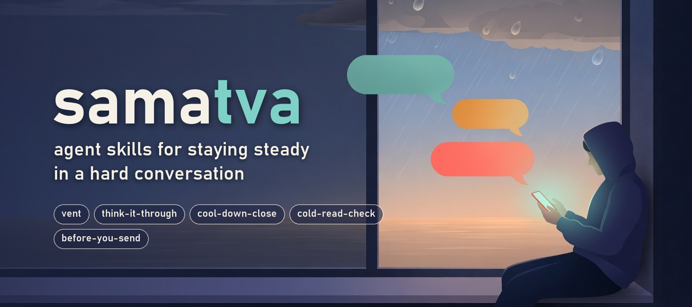

<p align="center"></p>

# samatva

samatva is a set of agent skills for the moment a conversation, or a person, has got under your skin. Say you're furious and need to vent, that a reading or a warning left you unsettled, or that you're about to send a message you might regret, and the `samatva` router picks one skill and holds to its rules: listen before anything else, never advise while you're flooded, never pass judgement on the people you talk about, and hand you back to a human when the session is done.

The name is Sanskrit for equanimity, from the Gita's *samatvam yoga uchyate*, "evenness of mind is called yoga".

The skills use the open [Agent Skills](https://agentskills.io) format (a folder with a `SKILL.md`), so they can be invoked at the start or in the middle of a conversation with any agent that reads skills. There is no app and no server.

## The honest limit

A skill cannot enforce anything. It is text a model reads, and a sycophantic host model can ignore every rule in it. The design this repo comes from ([docs/architecture.md](docs/architecture.md)) puts restraint in a controller outside the model for exactly that reason. Skills have no controller, so samatva carries the restraint rules in the skill text, recovers some of the gates with optional scripts where your agent can run them, and ships an eval set so you can measure whether your host model actually holds the rules. Run the evals before you trust it.

samatva is not therapy and not a crisis service. Every skill checks for self-harm, harm to others, and being harmed, and when it sees a signal it stops and points to a person and a crisis line instead of carrying on.

## Skills

| Skill | Use it when | |
|---|---|---|
| `samatva` | any upset; it picks the skill for you | coming soon |
| `vent` | you're angry or flooded, "I just need to vent" | coming soon |
| `think-it-through` | you're calmer and want to decide | coming soon |
| `cool-down-close` | the session is long or you're ready to stop | coming soon |
| `cold-read-check` | a reading, warning, or prediction left you unsettled | coming soon |
| `before-you-send` | you want to write to someone while angry | coming soon |
| `voice-setup` | you want replies to sound like you | coming soon |

## Install

### Claude Code

```sh
claude plugin marketplace add lokeshrana9999/samatva
claude plugin install samatva@samatva
```

### Other agents

From your project root, with Node.js installed:

```sh
npx skills add lokeshrana9999/samatva --skill '*' --agent codex -y
```

Replace `codex` with your agent (`cursor`, `gemini-cli`, ...). Add `-g` to install for every project.

## What every skill holds to

1. Listening before influence. The righting reflex (advise, fix, correct, reassure) is forbidden by name.
2. No characterisation of anyone you mention beyond reflecting your own words back.
3. Honest identity: never claims to be human or to have feelings.
4. No retention hooks. Sessions close and point at a person, never at coming back.
5. Crisis handoff over continued chat.
6. No memory writes about your relationships, family, or finances while a skill is active.
7. Restraint beats voice: a voice profile sets the surface of a reply, never its content.

## Contributing and license

[CONTRIBUTING.md](CONTRIBUTING.md) has the repo layout, the rules for changing a skill, and the privacy rules for fixtures; [PRIVACY.md](PRIVACY.md) says what is read and what is written; [CHANGELOG.md](CHANGELOG.md) lists what changed. MIT, see [LICENSE](LICENSE). The cover art in `docs/assets/` and the plugin icon were generated with Grok Imagine (xAI); the wordmark is set in Bahnschrift.
